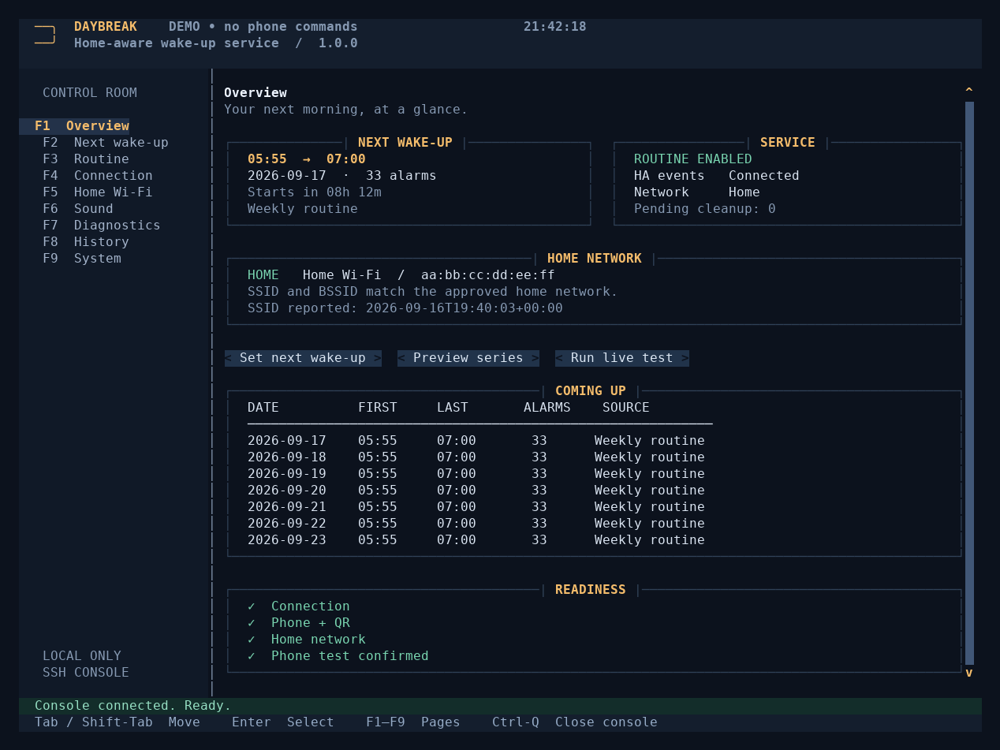
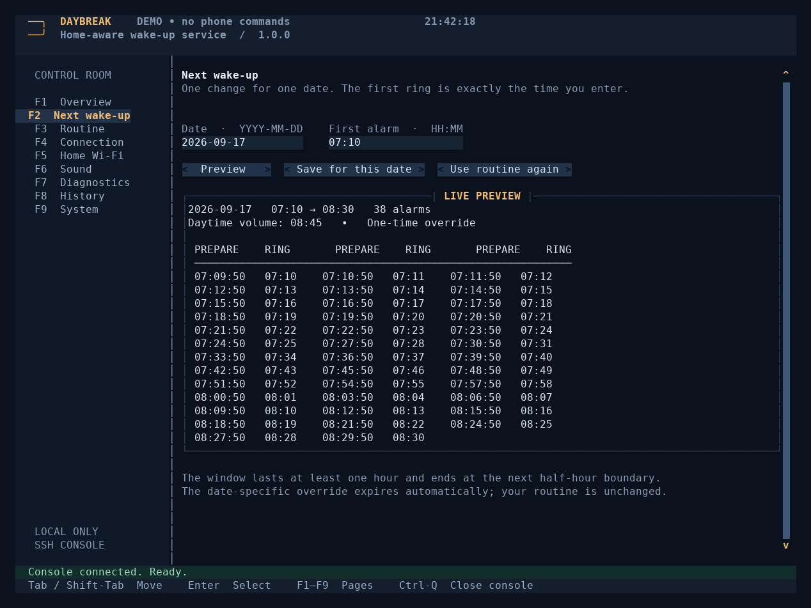

# Daybreak

**An independent, home-aware wake-up service with a complete SSH control room.**

Daybreak schedules Android Clock alarms through Home Assistant, restores the
right volume shortly before each ring, and ends the morning when you hold your phone near your
bathroom NFC tag. Scheduling and completion live on the server, not in a Home
Assistant automation. Your normal Home Assistant controls remain separate.



## What it does

- Exact first-ring times. No hidden five-minute offset.
- Alarms repeat every minute until tag confirmation.
- Alarm creation and loud-volume commands begin **the configured preparation lead before each ring**.
- **Home Wi-Fi only:** both the reported SSID and BSSID must match your approved
  networks. Away/Unknown inhibit new wake-up commands and queue cleanup.
- The same Wi-Fi rule covers the optional evening alarm.
- Pair a Home Assistant NFC tag by tapping it with your phone. Completion is
  durable and applies to the active wake-up, even after midnight.
- A one-time next wake-up, weekly routine, live previews, phone/network tests,
  history, service administration, Git deployment and backups — in the console.
- No browser UI, cloud account, inbound TCP control port or Docker socket access.

All user-facing text is English. Names do not depend on a phone brand.

## Install once

### Requirements

A Linux **host** running systemd, Python **3.10+**, Python venv support, Git,
Internet access to install dependencies, and root access for installation.
A UTF-8 terminal of at least **100 columns × 30 rows** is recommended; the
screenshots use 122 × 43. Pages scroll in smaller windows.

Home Assistant must expose its authenticated REST and WebSocket APIs to the
host. The Android Companion app needs its already-working notification commands,
Wi-Fi Connection and Wi-Fi BSSID sensors, and **Persistent Connection → Always**.
Use a writable NFC tag (NTAG213 is sufficient). Write a new Home Assistant tag
from the Companion app before pairing it in Daybreak.

Put the contents of this repository at the root of your GitHub repository.
Do **not** copy server configuration, tokens, databases or diagnostic reports
into that repository. The app creates them separately.

On the host via SSH:

```bash
git clone YOUR_GITHUB_REPOSITORY_URL daybreak
cd daybreak
sudo bash install.sh
sudo daybreak
```

Replace `YOUR_GITHUB_REPOSITORY_URL` with your repository's clone URL. The initial
clone/install is the only deployment setup outside the TUI. All normal operation
and later Git deployments are available inside it.

The installer builds an isolated release before replacing service files, then
starts the **control service**. A fresh installation is **not armed** for daily
wake-ups. The console lets you finish setup, test the phone, and enable it.

If a previous single-file Daybreak is installed, the installer backs up its unit
and launcher and replaces that same `daybreak` service. The new program does not
read the old JSON configuration or SQLite schema; its configuration starts fresh.
Previous files are left intact. Keep earlier HA wake-up automations disabled.

## First-run setup — entirely inside Daybreak

Open with **`sudo daybreak`**. Use **F1–F9**, **Tab**, **Shift-Tab** and **Enter**;
mouse selection/scrolling also work. **Esc** closes a dialog. **Ctrl-Q** closes
the console, not the background service.

### 1. Connection

In **F4 · Connection**:

1. Enter the **Home Assistant URL** and **Long-lived access token**, then select
   **Save connection**. Use the API-accessible base URL, not `/api`; redirects to
   an extra login portal are not followed. Use HTTPS for non-local connections.
2. Select **Choose phone** and choose the working `notify.mobile_app_…` action.
3. Select **Pair NFC tag**, hold your phone near the bathroom tag, review the
   captured tag and device identifiers, then choose **Use captured tag** and confirm.
   **Cancel pairing** discards a capture. Replacing either saved identifier pauses
   daily wake-ups and clears the old phone-test confirmation; test again before enabling.
4. Use **Check connection**. Keep the existing Clock package unless your phone
   uses a different tested app.

Create a token beforehand in HA **Profile → Security → Long-Lived Access Tokens
→ Create Token**. Daybreak cannot issue the initial HA credential for you. A
saved token is masked and is never returned by the control API.

### 2. Home Wi-Fi

In **F5 · Home Wi-Fi**, with the phone on your home network:

1. **Choose SSID sensor**, then **Choose BSSID sensor**. The searchable lists show
   names, identifiers and current states; select both from the same phone.
2. Select **Use current Wi-Fi** and confirm that the displayed network is home.
   This records the current names without retyping them.
3. Check that the live report says **Home**. **Save home network** stores any
   manual list changes. Additional approved access points can be added here.

Public IP is not used. The optional phone heartbeat can be left empty; ordinary
Wi-Fi values may legitimately remain unchanged for hours.

### 3. Real tests

In **F7 · Diagnostics**:

- **Run rolling test** prepares three real alarms one minute apart, at the same
  configured lead time as the real routine. Let two ring, then hold your phone near the bathroom
  NFC tag. Check cancellation and daytime volume; wait for pending cleanup to reach
  zero and choose **Confirm test passed**.
- **Run Wi-Fi test** prepares one real test alarm. Once prepared, take the phone
  off home Wi-Fi and check that the console changes to Away/Unknown, Daybreak
  cancels the test alarm and restores volume. Reconnect afterwards. Confirm only
  after checking the phone itself.

Test sessions have separate identifiers and do not mark a real morning complete.
If a test is interrupted, its cleanup is recovered on the next service start.

### 4. Enable

In **F9 · System**, choose **Enable daily routine**, then **Enable autostart**.
Enabling the routine requires complete setup and a confirmed live phone test.
**F1 · Overview** shows the next plan, network, readiness and connection.

## Moving from a printed QR to NFC

1. Keep the old tag configured until the NFC tag can be read reliably. In the
   Android Companion app, open **Settings → Tags**, create a **new** tag and write
   it to the NFC sticker. Do not write the old QR identifier to the sticker.
2. Outside a running wake-up or live test, pair the new tag in **F4 · Connection**.
   Review both identifiers before saving. The old identifier is no longer accepted
   by Daybreak after replacement. Daily wake-ups pause until the new test is confirmed.
3. Run **F7 · Diagnostics → Run rolling test**. After two rings, tap the NFC tag;
   verify cancellation and restored volume on the phone, wait for zero cleanup,
   and confirm the test. Check the real lock-screen/NFC behavior on your phone.
4. Update any separate HA consumers of the old tag (custom integrations, morning
   brief handlers, automations). A tag-registry deletion alone is not revocation
   of consumers that still match the old identifier. Remove the old registry entry
   and printed QR only after the NFC path works and the old tag is ignored.
5. Enable the daily routine again in **F9 · System**. Keep a separate alarm until
   the first real morning has been verified.

The service still reads existing settings and backups. Internal `qr_tag_id` and
`qr_device_id` keys are retained for compatibility; they now identify the wake-up
**tag**, regardless of medium. Existing history is preserved. New completions use
`Tag`; historical `QR` completions remain readable. `/status` adds `last_tag`,
`wake_tag_id` and `wake_tag_device_id`, while keeping `last_qr` as a compatibility
alias for existing HA status bridges. Changing labels alone does not re-pair or
invalidate an existing QR.

Standard HA NFC and QR tags produce the same `tag_scanned` event with `tag_id`
and `device_id`. A fresh identifier retires the old QR, but it does not prove that
future events came from NFC rather than a copy of the new identifier. Do not put
your HA token or password on the tag. See the [Companion tag documentation](https://companion.home-assistant.io/docs/integrations/universal-links/).

## Android 10-second mode

The optional [Daybreak Android app](android/README.md) takes over the daily alarm
after a locked-phone test. It prepares the next ring and raises Android's alarm
stream to maximum two seconds before each 10-second slot. Silencing a ring
leaves the next slot on the same clock. An alarm already playing keeps playing
through the slot.

In **F6 · Sound**, show the pairing key and save it in the installed app. Allow
exact alarms, notifications and lock-screen alerts in Android. Run **Test Android
link** with the phone locked. Silence the first ring, let the second ring, then
scan your usual wake-up tag. Check that the app stops and restores the old alarm
volume before selecting **Enable 10-second mode**.

The server sends signed start, refresh and stop commands via Home Assistant
Companion. The app needs no Home Assistant token. The mode uses the active wake-up
on the server and does not create a Google Clock evening alarm. If delivery is
interrupted, the phone stops after the current authorization expires (up to 75
seconds from the last refresh). The server resumes an unfinished wake-up when
delivery becomes available again. **Use Google Clock** restores minute repeats.

## Schedule semantics

Default settings:

| Setting | Default |
|---|---|
| Weekly first alarm | 05:55, every day |
| Repeat interval in Google Clock | Every minute until tag confirmation |
| Preparation lead | 10 seconds |
| Daytime volume restored | After tag confirmation |
| Evening preparation | 22:00, one alarm at the next day's exact first-ring time |
| Wake-up volume | Alarm 7, ring 7 |
| Daytime volume | Alarm 4, ring 3 |
| Time zone | Europe/Warsaw |

The preparation lead is configurable from 1 to 45 seconds. Existing saved
settings retain their value until changed in **F3 · Routine**. The setting is a
server dispatch window, not a guaranteed phone-delivery time: REST, Companion and
Clock must process the commands within it. Requests use the remaining time budget;
Daybreak stops sending wake-up commands at the deadline rather than replaying them
late. A live one-second test rolled an alarm to the following day when Clock processed
it too late, so the fresh-install default remains 10 seconds. Shorter values need
a real phone test before relying on them.

The first ring is at the entered time. Google Clock repeats every minute until
tag confirmation. The Android app mode repeats every ten seconds.
An unfinished wake-up remains active across midnight. If a later day's start
passes while it is active, both dates are covered by the same confirmation.

**F2 · Next wake-up** changes one explicit date. Its preview shows the first
nine preparation and ring times. **F3 · Routine** edits
the default weekdays. A blank weekday leaves that day unscheduled. Overview
shows whether a wake-up is waiting for its tag and when the next alarm is due.

An existing evening alarm is reconciled when a future plan changes: the old
tracked alarm is cancelled before a replacement is created. A session already
under way keeps its original timeline. Changes are validated before writing and
configuration backups are kept automatically.

Closing SSH never owns the scheduling loop. Restarting the service preserves tag
completion, plans, tracked alarms and pending cancellation. Missed past alarm
times are not replayed. Nonexistent DST local times move to the first valid local
minute; an ambiguous autumn time uses its first occurrence. The console preview
is the source of truth for the resulting wall-clock plan.

## Clock entries and cleanup

Alarms are one-shot and created with Android's `EXTRA_SKIP_UI=true`, which asks
Clock to remove a newly-created alarm after dismissal. Actual removal depends on
the Clock implementation; HA accepting a dismissal does not confirm deletion.
Starting with 1.1.1, a successfully acknowledged evening alarm is not set again
before its first ring. Daybreak only prepares sound at the configured preparation time. This avoids
turning it into an identical reused alarm, which Android permits Clock to retain.
An unacknowledged creation is still retried, and sound-preparation retries do not
re-create an acknowledged evening alarm.

The unique `Daybreak_…` label is currently the ownership identifier used for
scoped dismissal. Blank labels or time-only cleanup cannot safely distinguish a
Daybreak alarm from a personal alarm at the same time. The standard Android
AlarmClock interface exposes dismissal, not a general API to list and delete old
Clock entries. Older retained entries therefore need separate, scoped cleanup;
clearing Clock's app data would also erase personal alarms and settings. See the
[Android AlarmClock contract](https://developer.android.com/reference/android/provider/AlarmClock).

## Home Wi-Fi behavior

Daybreak observes authenticated HA sensor states and network-change events,
with periodic state reads and Companion sensor-refresh requests. **Home** requires
an established HA event connection, matching SSID and matching BSSID. **Away**
means a different/disconnected reported network. **Unknown** means missing,
unavailable or unusable information, or no HA connection. New alarm and loud
commands require Home; normal-volume restoration and cancellation may run while
away because they are cleanup, not new wake-up commands.

These are the phone's **reported** network states, not a direct instantaneous
measurement by the router. Fetching an old state does not make it fresh, and
Companion can leave the timestamp unchanged when a value has not changed.
The UI shows the report timestamp. An optional suitably-updating heartbeat
sensor adds an age check. Verify transitions with your actual phone before
relying on home-only behavior. Cleanup is retained for retry if transport fails;
HA accepting a request is not proof of phone execution.

An unfinished wake-up waits for the tag during Away/Unknown. Returning Home
allows future alarms after pending cleanup. Expired alarm times are skipped.

## Console pages

| Page | Controls |
|---|---|
| Overview | Next session, service/network readiness, coming-up list, shortcuts |
| Next wake-up | Date/time, live timeline, one-date override and routine reset |
| Routine | All weekdays, preparation lead, evening seed |
| Connection | URL, masked token, notification picker, clock package, timezone, NFC tag pairing |
| Home Wi-Fi | Sensor pickers, SSID/BSSID lists, current-network capture, polling/refresh |
| Sound | Four volume levels and live test |
| Diagnostics | Connectivity, sensor refresh, rolling/Wi-Fi tests, cleanup, last tag/errors |
| History | Filtered events, morning summaries, sanitized support export |
| System | Service/autostart, Git deployment, configuration backup/restore |



## GitHub workflow

Develop/commit/push from the computer. On the server, open **F9 · System** and use
**Pull & deploy**. The server checkout must be clean; Daybreak uses fast-forward
pull only, builds a new release, checks imports, switches the service and reopens
the console. It never writes credentials into the checkout or silently resets
local Git changes. Git runs as the checkout owner and uses that owner's existing
Git authentication. Configuration, token and history survive deployments.

The repository includes GitHub Actions for Python 3.10–3.13. Those jobs will run
in **your** repository after you push; the supplied local test report does not
claim a hosted CI run.

## Data and installation layout

```text
/opt/daybreak/releases/…/       Isolated installed source and virtual environment
/opt/daybreak/current           Active release symlink
/usr/local/bin/daybreak         Console launcher
/etc/systemd/system/daybreak.service
/etc/daybreak/source-path       Source checkout used by Pull & deploy
/var/lib/daybreak/settings.json Private settings, no token
/var/lib/daybreak/credentials   Private HA token
/var/lib/daybreak/daybreak.sqlite3  Sessions, alarm ledger, history, next override
/var/lib/daybreak/backups/      Settings backups, without token
/run/daybreak/control.sock     Restricted local Unix control socket
/var/backups/daybreak/          Service/launcher backup made during installation
```

The scheduler runs as the unprivileged `daybreak` system user. The administrative
console is opened through `sudo`; system operations use fixed argument vectors,
not shell interpolation. The unit limits writable paths and has no privileged
Docker integration. `.gitignore` excludes credentials, local settings, SQLite
files, environments and support reports. It is still important to inspect what
you commit.

## Development and preview

```bash
python3 -m venv .venv
.venv/bin/pip install -e '.[test]'
.venv/bin/python -m pytest -q
.venv/bin/daybreak --demo
```

The demo uses generic synthetic data and sends no phone commands. The terminal
is implemented with **prompt_toolkit**. Screenshots in `docs/` were rendered from
the actual 1.0 console; tag labels changed in 1.1. Test adapters use loopback HTTP,
WebSocket and Unix sockets; they do not require a live HA account.

For an isolated daemon during development, the CLI accepts `--daemon`,
`--state-dir` and `--socket`. Normal use does not require those flags.

## Verification

See [TEST-REPORT.md](TEST-REPORT.md) for the exact local test environment and
commands. [docs/DESIGN.md](docs/DESIGN.md), [docs/PLAN.md](docs/PLAN.md) and
[docs/SOURCES.md](docs/SOURCES.md) document the architecture and primary sources.

Live Android execution, your server's systemd activation and a complete overnight
run must be checked on your equipment. Daybreak logs “HA accepted” deliberately:
there is no claim of physical delivery or a guaranteed wake-up based solely on
an API response. The in-console live tests are part of first-run setup.

## License

MIT. See [LICENSE](LICENSE).
